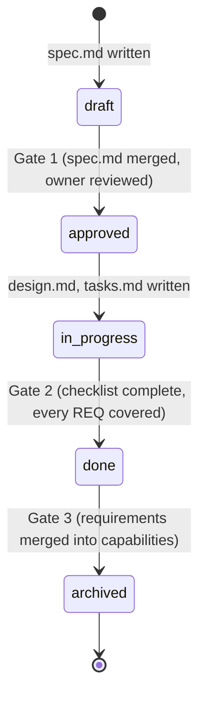

# Spec-Driven Development

**Every change starts with why, is written before code, and ends by updating the truth.**

This repository is a method, a set of templates and a set of agent skills for spec-driven development (SDD). It works for one developer starting a project and for an organisation with many teams and many repositories. It is opinionated: one structure, one lifecycle, and a handful of documented variants.

## The method in one picture



Two folders carry the truth:

- `specs/changes/` holds numbered units of work. A change is born, implemented and archived.
- `specs/capabilities/` holds how the system behaves today. Capabilities never finish; they absorb archived changes.

## Layout

```
specs/
  constitution.md          the rules of this project, one page
  INDEX.md                 generated view of changes and capabilities
  templates/               copied into each new change or capability
  capabilities/
    <capability>/spec.md   living truth, one folder per capability
  changes/
    001-name_of_change/
      spec.md              why it matters, what should be done, scope, success
      requirements.md      testable SHALL statements with stable IDs
      design.md            how, and the decisions behind it
      tasks.md             ordered checklist, each task citing requirement IDs
      checklist.md         the gates to done and to archived
  archive/
    001-name_of_change/    finished changes, cold storage
```

## Start here

- [The method](docs/method.md): the complete reference in one page per topic.
- [The constitution of this repository](specs/constitution.md): the rules this repo follows, which double as an example.
- [Change 001](specs/changes/001-spec_layout_and_lifecycle/spec.md): this repository specifies itself. The first change defines the layout and lifecycle you are reading about.
- [Templates](specs/templates/): what every file in a change looks like.

## Status

Early. The structure, templates and first change exist. Skills, role guides and the validator are the next changes.

## License

MIT. See [LICENSE](LICENSE).
