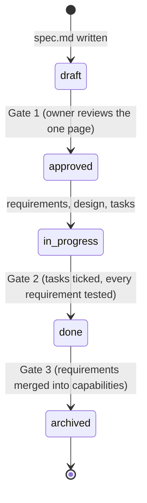

# Spec-driven development

**Every change starts with why, is written before code, and ends by updating the truth.**

A method, a set of templates, six skills and a validator for spec-driven development. The skills are procedures for agents, the coding assistants such as Claude Code or Devin that read a repository and do the typing, and every one of them can be followed by a person instead. It works for one developer starting a project and for an organisation with many teams and many repositories. It is opinionated: one structure, one lifecycle, and a handful of documented variants.

## What it is

Write down what a change should do and why it matters before any code. Keep that record true as the code evolves. When the work ships, the record becomes the description of how the system behaves today. People and agents follow the same procedure and leave the same trail: a numbered change, requirements with stable ids, commits that name them, and a living capability spec at the end.

Two folders carry the truth. `specs/changes/` holds numbered units of work that are born, implemented and archived. `specs/capabilities/` holds how the system behaves today, and never finishes. [Why this method, and what it fixes in the existing tools.](what-and-why.md)

## Why adopt it

Specs written before code tend to die within months: nothing updates them when the code changes, the folder becomes unreadable past a few dozen, and a small change carries the same ceremony as a large one, so people route around the process. This method gives every spec a lifecycle it cannot skip, keeps the active list short by merging finished work into living capability specs, and scales the ceremony down for small changes. A validator checks the mechanical rules and names the reason behind each one.

## Your first change

Install the skills with one script, open your agent, and take a small change from nothing to an archived capability. Six steps, each with the transcript of a real run.

[Start the tutorial](tutorial/index.md){ .md-button .md-button--primary }

You need `git`, Python 3.9 or later for the validator, and an agent. Allow about thirty minutes: the agent works for fifteen, and the rest is your reading, four short answers and one approval.

Tested with **Claude Code** and **Devin CLI**. Other agents that read the open skills standard are [listed as untested](agents.md).

## Find your way in

- [For developers](for-developers.md): the questions you have, in the order they come up.
- [For team leads](for-team-leads.md): constitution, ownership, the index, many repositories.
- [A real example](examples/greenfield-go.md): a Go project as the skills produced it, with its commit history.

## The reference

- [The method](method.md): every rule, one page per topic.
- [The six skills](skills/index.md): the procedures agents run and people can follow by hand.
- [Templates](reference/templates.md): what every file in a change looks like.
- [The validator](reference/validator.md): what it checks and why each rule exists.

The repository is on [GitHub](https://github.com/eaceto/spec-driven-development), under the MIT licence. It practises the method on itself: its own `specs/` folder holds the changes that built it.
