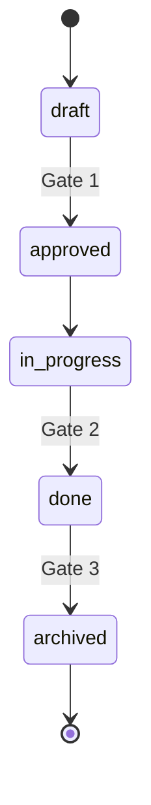

# The method

This page is the reference. For a guided first change, start at [the tutorial](tutorial/index.md); for the reasoning, read [what it is, and why](what-and-why.md).

One sentence: **every change starts with why, is written before code, and ends by updating the truth.**

Everything below is the reference behind that sentence. Each section is short on purpose. If a rule here cannot be stated in one sentence, it is a bug in the method.

## Two folders

| Folder | Holds | Lifetime | Who writes it |
|---|---|---|---|
| `specs/changes/` | Numbered units of work | Born, implemented, archived | The author of the change |
| `specs/capabilities/` | How the system behaves today | Never finishes | Only the archive step |

A change is the unit of intent and review. A capability is the unit of truth. Changes feed capabilities when they are archived, so the number of active changes stays small and the capabilities stay current.

## Five files

A change lives in `specs/changes/NNN-name_of_change/` and declares a tier in its frontmatter.

| File | Written for | Answers | quick | standard | full |
|---|---|---|---|---|---|
| `spec.md` | People | Why it matters, what should be done, scope, success | yes | yes | yes |
| `requirements.md` | People and agents | Testable SHALL statements with IDs | no | yes | yes |
| `design.md` | Engineers and agents | How, and the decisions behind it | no | yes | yes |
| `tasks.md` | Agents and engineers | Ordered steps citing requirement IDs | yes | yes | yes |
| `checklist.md` | Reviewers | The gates | yes | yes | yes |
| `guardrails.md` | Agents | Constraints unique to this change | no | no | yes |

The one rule that keeps tiers honest: **a quick change may not add, modify or remove a requirement.** If behaviour changes, requirements change, so the change is at least standard.

`spec.md` has a fixed order: why it matters, what should be done, scope with explicit non-goals, success criteria. Anyone should understand it in five minutes without reading code.

## Five states, three gates



| Gate | From | To | Condition |
|---|---|---|---|
| 1 | draft | approved | `spec.md` is merged to the main branch through a pull request reviewed by the owner of every capability it touches. `approved_by` and `approved_at` are filled in. |
| 2 | in-progress | done | Every checklist item for Gate 2 is ticked. Every requirement ID is covered by a test or listed as not testable with a reason. An id in a test file is the floor the validator can check; whether the test proves the scenario is judgement, and the reviewer's. |
| 3 | done | archived | The archive step has merged requirements into capability specs, moved the change to `specs/archive/`, and regenerated the index. |

Design and code do not start before Gate 1. Status fields are changed by the gates and the archive step, not by hand.

## Requirements and IDs

A requirement is one SHALL statement with at least one scenario.

```markdown
### REQ-014-03: Session timeout
When a session is idle for 30 minutes, the system SHALL invalidate it.

#### Scenario: Idle session expires
- GIVEN an authenticated session
- WHEN 30 minutes pass without a request
- THEN the next request is rejected and the user must sign in again
```

- The ID encodes the change that created it: `REQ-014-03` is the third requirement of change 014.
- A modified requirement keeps its ID and gains a "Changed in" line. Tests and commits that cite it stay valid.
- A removed requirement is listed under Retired in its capability. IDs are never reused.
- Any requirement may carry an optional `Ref:` line linking to a ticket or a document.
- Requirements are grouped under the capability they belong to, so the archive step knows where to merge them.

## Numbering and claiming

Change directories are `NNN-name_of_change`: three digits, a dash, then lowercase words joined by underscores. The number is the highest existing number across `changes/` and `archive/` plus one.

In a team, two people can pick the same number on separate branches. The claim rule prevents it: **the first thing merged to the main branch for a change is its directory with `spec.md` alone.** The number is taken at that moment. If two claims collide, the one merged later is renumbered. A validator flags duplicates.

Documented variant: `numbering: ticket` in the constitution, where the directory is `ABC-123-name_of_change`, the change id is the tracker key `ABC-123`, and requirement ids are `REQ-ABC-123-01` onward. The validator accepts this form when the constitution says so.

## Ownership and approval

Every capability has an owner, declared in its frontmatter. Every change lists the capabilities it touches. A change is approved when the owner of each touched capability has reviewed `spec.md`.

With GitHub or GitLab this costs nothing extra. Map `specs/capabilities/<name>/` to the owning team in `CODEOWNERS`, and the archive pull request that merges requirements into that capability requires their review automatically. For Gate 1, the reviewer reads the `capabilities` list in the frontmatter. A small CI check can request the reviewers for you.

Changes to the constitution list `constitution` as a capability and are reviewed by the constitution's owner.

## Commits and pull requests

The subject line follows whatever convention the team already has, such as Conventional Commits or a tracker key. Traceability goes in git trailers, which tools can parse and which no existing convention fights over.

```
Add passwordless login endpoint

Change: 014
Requirements: REQ-014-01, REQ-014-03
```

- `Change:` appears on every commit that belongs to a change.
- `Requirements:` lists the IDs whose code or tests the commit adds. Optional, but it is what lets Gate 2 be checked mechanically.
- Pull request titles start with the change number, `014: Passwordless login`, so reviewers see it in the list.

`git log --grep "^Change: 014"` returns a change's history. `git interpret-trailers --parse` extracts the IDs for tooling.

A squash merge keeps the `Change:` trailer in the squashed message and lists every `Requirements:` id the squashed commits delivered, so the trail survives the squash.

## Tickets and documents

A change may link a ticket and a document in its frontmatter, and any requirement may link one with `Ref:`. The fields are generic. Jira and Confluence are examples, not dependencies.

The rule of truth keeps this from becoming triple maintenance:

| System | Holds | Never holds |
|---|---|---|
| The spec | Intent and requirements | Who is working on it this sprint |
| The tracker | Scheduling, assignment, progress | Requirements |
| The wiki | Background, research, meeting notes | Requirements |

Links go one way, from the spec outward. There is no status sync.

## The constitution

Each project has `specs/constitution.md`: its purpose, up to ten principles, definitions and an amendment log. It fits on one page. Agents load it on every run, so every extra line costs tokens on every task.

Its frontmatter is the only configuration the method has:

| Key | Meaning |
|---|---|
| `extends` | The organisation constitution and version this project builds on, or `none` |
| `numbering` | `sequential` or the `ticket` variant |
| `sdd_version` | The version of templates and skills the project pins |
| `validator` | Optional. The command skills run to check the specs. Set when the validator is installed |

A project constitution may add rules to the one it extends. It may never relax one.

## Many repositories

Specs live in the repository whose code they govern. Nothing else keeps them honest.

An organisation with many repositories adds one thin central repository holding:

- the organisation constitution, versioned, which project constitutions extend;
- the pinned version of templates and skills;
- an aggregated index built from every repository's `INDEX.md`.

Cross-team initiatives do not get a spec of their own. They get an epic in the tracker, and each affected repository has its own change linking that epic. The aggregated index groups by epic.

Across repositories a change is `repo-name:014` and a requirement is `repo-name:014/REQ-03`. Inside a repository the short form is enough.

## Scale

- Changes are a flat list. Status lives in frontmatter. `INDEX.md` is generated and is what people and agents read.
- References in prose, commits and tickets use the change number, never the path, so moving a change to the archive breaks nothing. The index is regenerated at every step, so its links never go stale.
- The loading rule for agents and people: constitution, index, one change, and only the capabilities that change lists.
- The archive is cold storage. Nothing loads it unless asked.

Capabilities are a flat list. If a project ever has so many that a flat list fails, that is the moment to design grouping, with the validator changed alongside; the method does not pre-empt it.

## Adopting in an existing project

Do not specify the whole codebase. Maintainers of every existing tool say the same thing, and generated requirements are noise nobody owns.

1. Write the constitution from what already exists: the README, architecture decisions, CI rules. Invent nothing.
2. Write a capability map: one paragraph per capability, no requirements. It seeds the index and the ownership table.
3. Spec the next change you were going to make anyway. Its `spec.md` records the as-is behaviour of the area it touches.
4. Repeat. Capabilities grow from the edges inward, and only where someone cared enough to change something.

## Agents

Skills live in `skills/<name>/SKILL.md` in the open Agent Skills format. Installing them into a project links that folder into `.agents/skills/`, read by Devin and Codex among others, and `.claude/skills/`, read by Claude Code. The repository root carries `AGENTS.md` with the loading rule and lifecycle rules. `CLAUDE.md` points to it.

### The validator

`specs/validate.py` checks the mechanical rules of the method and names the requirement behind each one. It is one Python 3 file with no dependencies, installed by `install.sh`, which also sets `validator: python3 specs/validate.py` in the constitution so the skills run it before reporting.

```
python3 specs/validate.py            whole tree
python3 specs/validate.py 014        one change
python3 specs/validate.py --rules    what it checks, and why
```

Exit codes: 0 clean, 1 violations, 2 usage error. Each violation is one line: path, rule id, the requirement ids it enforces, and what to fix. The checks cover layout, naming and numbering, tier files, the order of `spec.md`, frontmatter, requirement grammar and grouping, capability specs, status consistency including test coverage and archive merges, the index, the constitution, the agent entry file, commit trailers when git is available, and the skills when a project ships them. It does not judge whether a purpose is well written or a design is sound. Those remain with people and skills.

The six skills map to the lifecycle: `sdd-init`, `sdd-new`, `sdd-plan`, `sdd-implement`, `sdd-verify`, `sdd-archive`. Each is a procedure a person can follow by hand, with the same five sections: when to use, preconditions, steps, refuse when, done when. Skills read templates from the project's `specs/templates/`, and `sdd-init` carries a bundled copy so it can create that folder.

### Installing the skills

From a checkout of this repository:

```
./install.sh /path/to/your-project
```

The script copies the six skills into `.agents/skills/` and `.claude/skills/` of the project, bundles the templates into `sdd-init`, writes the version into `sdd_version` in the project's constitution if one exists, and creates a `CLAUDE.md` pointing to `AGENTS.md` if the project has none. Then, in your agent, run `sdd-init`. To upgrade, run the script again from a newer checkout; the version in the constitution shows what a project is on. For working on the skills themselves, `./install.sh . --link` symlinks instead of copying.

## Where the method came from

It was shaped by studying how teams use spec-driven tools and where they stop. The stopping points, stale specs, unreadable folders, ceremony that does not scale down and nobody knowing who approved what, are what the lifecycle, the tiers, ownership, the index and the validator answer.
