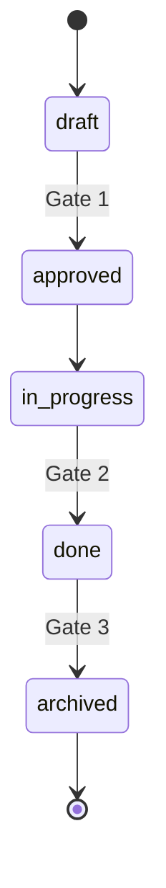

# What it is, and why this method

## Spec-driven development in one paragraph

Spec-driven development means writing down what a change should do and why it matters before anyone writes code, then keeping that record true as the code evolves. The spec is not documentation written after the fact. It is the contract the work is checked against, and when the work ships, it becomes the description of how the system behaves today.

Agents made this urgent. An agent given a vague request produces a confident guess. An agent given a spec with testable requirements produces the thing the spec describes, and a reviewer can tell the difference. The method on this site is written so that a person and an agent follow the same procedure and leave the same trail.

## The problem it solves

Teams that try spec-driven development with today's tools tend to stop within months, for the same four reasons:

- **Specs go stale.** Nothing updates them when code changes, so within weeks they describe a system that no longer exists.
- **The folder becomes unreadable.** Past a few dozen specs nobody can find the one that matters, and agents load everything.
- **Small changes carry the same ceremony as large ones.** People route around the process, and routing around it becomes the process.
- **Nobody can say who approved what.** Status fields are never updated, so a spec marked draft may be in production.

## What this method does differently

**Two folders, not one.** Numbered *changes* describe units of work and are born, implemented and archived. *Capabilities* describe how the system behaves today and never finish. Archiving a change merges its requirements into the capabilities it touched, so the active list stays short and the truth stays current.

**Purpose first.** Every change opens with why it matters and what should be done, before scope, before requirements, before any design. A change whose purpose cannot be stated is not ready.

**Three tiers.** A quick change holds three files and may not touch requirements. A standard change holds five. A full change adds guardrails. One rule keeps the tiers honest: if behaviour changes, requirements change, so the change is at least standard.

**Five states, three gates.** Draft, approved, in progress, done, archived. A person approves at Gate 1. Gate 2 requires every task ticked and every requirement referenced by a test. Gate 3 is the archive step itself. Statuses move by passing gates, never by editing a field.

**Requirements with stable identities.** One SHALL statement and at least one scenario each. The id names the change that created it, is kept when the requirement is modified, and is never reused. Tests, commits and tickets cite it.

**Enforced, not remembered.** Six skills carry an agent through the lifecycle and refuse to act in the wrong state. A one-file validator checks the mechanical rules and names the requirement behind every violation.

## Where it came from

GitHub's spec-kit, Amazon's Kiro and OpenSpec all split a spec into what, how and tasks, and each got something right. This method takes the numbered directories from spec-kit, the small file set and requirement traceability from Kiro, and the living-spec merge from OpenSpec. It adds what none of them has: a lifecycle with gates, tiers that scale ceremony down, capability ownership, an index so nobody loads everything, and a validator.

## Read next

- [Your first change in fifteen minutes](tutorial/index.md)
- [The method, in full](method.md)
